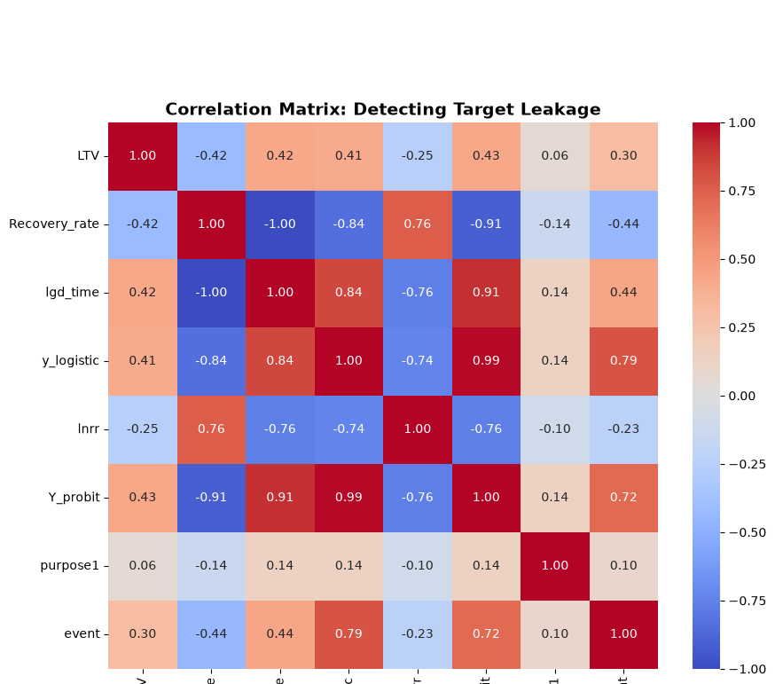
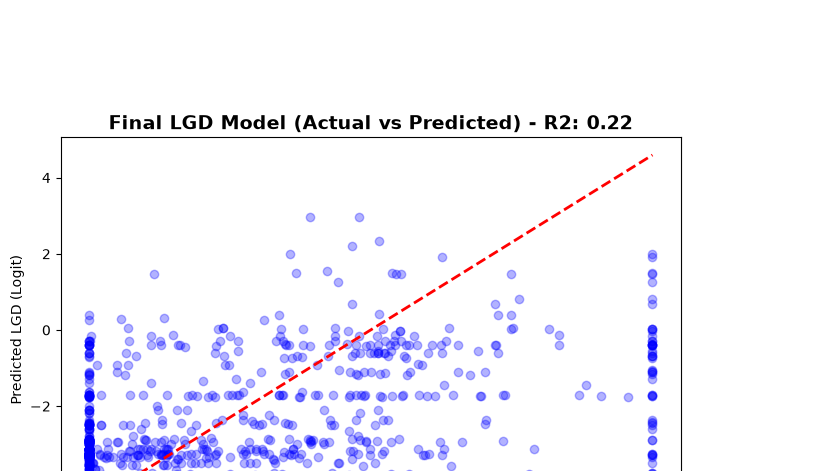
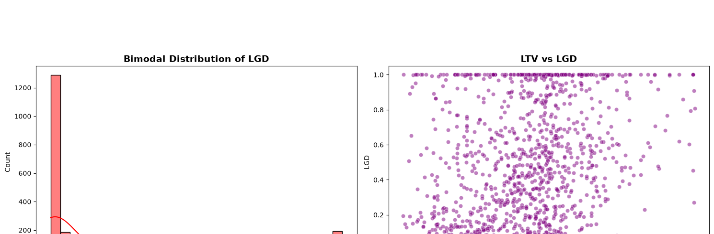

# LGD-Modeling-Engine
Machine learning pipeline to predict Loss Given Default (LGD). Features target leakage detection, Winsorization of bimodal data, and XGBoost regression.

# LGD (Loss Given Default) Modeling Engine

## Overview
This repository contains a machine learning pipeline to predict Loss Given Default (LGD) on a dataset of 2,545 defaulted loans. It demonstrates advanced statistical techniques to handle target leakage, extreme bimodal distributions, and non-linear regression.

*Note: For the Macro-Sensitive IFRS 9 Mortgage Engine, LGD is dynamically adjusted using a House Price Index (HPI) overlay. This repository focuses strictly on the statistical modeling of historical recovery rates.*

## Methodology

### 1. Data Audit & Target Leakage Detection
During the initial audit, a correlation matrix was generated. The feature `lgd_time` was discovered to have a **1.00 correlation** with the target variable. This was immediately dropped to prevent the model from "cheating" and producing a fake perfect score.

*Figure 1: Correlation Matrix. The dark red square between `lgd_time` and the target (`LGD`/`y_logistic`) proves perfect multicollinearity and target leakage.*

### 2. Handling Bimodal Distributions
LGD data typically exhibits a bimodal distribution (spikes at 0% loss and 100% loss). 
*   *Attempt 1 (IQR Capping):* Failed because the IQR bounds became mathematically useless (-28 to +16) due to the bimodal shape.
*   *Attempt 2 (Conditional Model):* Removing the 0s and 1s caused the R-squared to collapse to 0.09.
*   **Final Solution:** Applied 1% and 99% **Winsorization** to the Recovery Rate to stabilize the logit-transformed target.

*Figure 2: Winsorization of the LGD target. The extreme outliers at the tails are capped to stabilize the regression coefficients.*

### 3. Model Development
Trained an XGBoost Regressor using `LTV` and `purpose1` as predictors. The final model achieved an **R-squared of 0.2245**, representing a 24% improvement over the linear baseline.

*Figure 3: Actual vs Predicted LGD (Logit Scale). The model captures the central mass of the distribution.*

👉 **[Click here to view the Final Feature Importance Report](final_feature_mportance.txt)**

## Interactive Dashboard
The Streamlit app (`lgd_app.py`) allows risk managers to input a defaulted loan's LTV and Purpose to instantly predict the expected recovery rate and LGD.

*Figure 4: Interactive LGD Predictor Dashboard.*

---
**Author:** Raymond Sibanda | [LinkedIn](https://www.linkedin.com/in/raymond-sibanda) |
FRM | BSc Mathematics | BCom Honours Accounting
